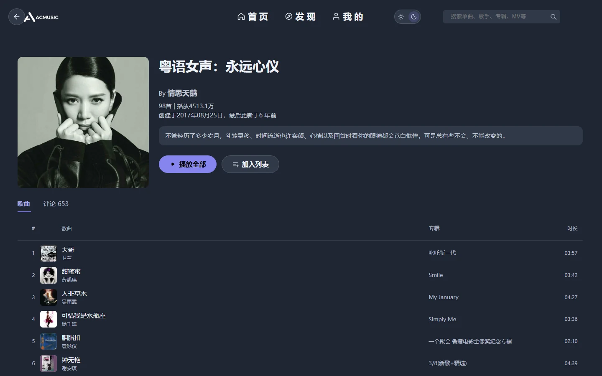

<h1 align="center">ACMUSIC</h1>

<p align="center">网易云音乐第三方 Web 客户端 · Vue 2 单页应用</p>

<p align="center">
  <a href="https://music.archai.space">在线体验</a> ·
  <a href="docs/DEVLOG.md">开发日志</a> ·
  <a href="CHANGELOG.md">更新日志</a>
</p>

<p align="center"></p>

## 能做什么

- **播放器**：逐字歌词、四条互不干扰的播放状态（队列策略 / 单曲形态含副歌与 A-B 区间 / 心动模式 / 定时停止）、系统媒体控制与全局快捷键、刷新后恢复队列与进度
- **音源**：音质档位按曲目实际拥有的档位自适应；官方无货或仅给试听片段时自动切解灰源；CDN 不可达时经服务端音频代理兜底
- **内容**：歌单、专辑、歌手、MV / 视频、搜索（智能匹配）、评论（支持楼中楼）、个人主页、年度听歌报告
- **外观**：深浅双主题 + 可换主题色，全站语义 token 化；切换主题时新主题从点击处圆形展开（切深色反向聚拢）
- **工程**：Vue Router history 模式 + 路由级分包 + 全局错误边界 + 骨架屏 + 封面懒加载；GitHub Actions 自动部署

<table>
<tr>
<td></td>
<td></td>
</tr>
<tr>
<td align="center"><sub>歌单详情</sub></td>
<td align="center"><sub>展开播放器 · 相似歌曲</sub></td>
</tr>
</table>

## 技术栈

- **Vue 2**（Options API）+ **Vue Router 3**（history 模式）+ **Vuex 3**（`UserAbout` / `TracksAbout`）
- **Element UI**（全局注册）、**xgplayer**（MV / 视频）、原生 `Audio`（音乐）
- **dart-sass** + vue-cli 5；ESLint 配置写在 `package.json` 的 `eslintConfig`

## 本地开发

```bash
yarn install
yarn serve        # http://localhost:8080，/api 已代理到线上后端，不用另起服务
yarn build        # 产物 dist/（prebuild 会先刷新应用内更新日志）
yarn lint
yarn serve:stop   # 端口被占或残留 dev server 时清掉 8080
```

## 环境变量

| 变量 | 默认值 | 说明 |
|---|---|---|
| `VUE_APP_API_BASE_URL` | `/api` | 接口网关前缀。开发时由 devServer 代理，生产时由 nginx 转发到自建 API 服务 |

前端不直连网易云，也不持有任何第三方 Key（IP 归属地等能力已在服务端代理）。

## 目录

```
src/api/            接口封装（统一 request 实例）
src/components/     通用组件、布局组件（layout/）、播放器（musicPlayer/）
src/pages/          路由级页面
src/mixins/         搜索等页面的共享逻辑
src/utils/          主题、音源、歌词、颜色提取等工具
src/assets/scss/    base/ 下是语义 token（唯一色值出处）
ops/nginx/          线上 nginx 配置镜像与部署手册（CI 不会部署它）
```

## 部署

- 推送到 `master` 触发 `.github/workflows/deploy.yml`（带路径过滤），构建产物发布到 VPS；失败时可用 `scripts/deploy.sh` 兜底
- **nginx 不由 CI 部署**，改 `ops/nginx/*.conf` 不会影响线上，操作步骤见 [`ops/nginx/README.md`](ops/nginx/README.md)
- git tag 不触发部署，发布动作与部署动作是两件事

## 说明

本项目为第三方客户端，仅供学习与自用，与网易云音乐官方无关。
音乐、封面、歌词等内容的版权归网易云音乐及相应权利人所有；接口来自开源项目 [NeteaseCloudMusicApi](https://github.com/Binaryify/NeteaseCloudMusicApi)。
