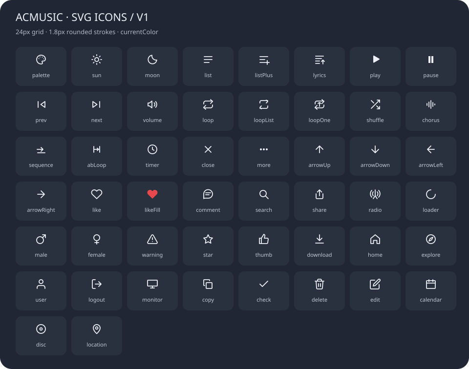

# 图标统一第一版

日期：2026-11-05。按用户要求实际接入界面，未新增依赖。

- 50 个业务图标统一内联 SVG，24×24 网格、1.8px 圆头圆角描边，颜色继承 currentColor。
- 播放、暂停、喜欢激活、更多点保留明确的填充形态。
- 搜索、评论、分享、私人 FM、喜欢从字体图标改为 SVG；返回、加载、性别、视频统计等显式业务 Element 图标也接入 BaseIcon。
- 保留点赞激活的兼容 class，屏蔽字体伪元素，避免重复画图或丢失红心状态。
- “加入列表”“歌词”“相似歌单”使用各自含义的图标；不再混用分享或电台。
- 移除独立图标 hover 缩放，交互反馈由外层按钮负责；加载图标保留旋转。
- 导航 20px、头像菜单 16px，细节信息按既有字号缩放。修复搜索 SVG 替换后旧字体 class 选择器导致的定位问题。

实页：首页 SVG 图标87个，BaseIcon 字体图标与 fallback 均0；导航3项均20×20/1.8px。头像菜单3项图标均16px、对齐正常；主题色菜单、搜索打开关闭正常，浏览器 error 日志为空。此统计仅针对首页业务图标，不代表 Element 内部原生控件的字体全部移除。

预览图来自真实注册表，可运行 `node scripts/update-icon-preview.cjs` 更新：

12组本地状态回归通过。lint、生产构建和diff检查结果见 CHANGELOG_AI.md。未执行账号写操作、未提交或部署。
